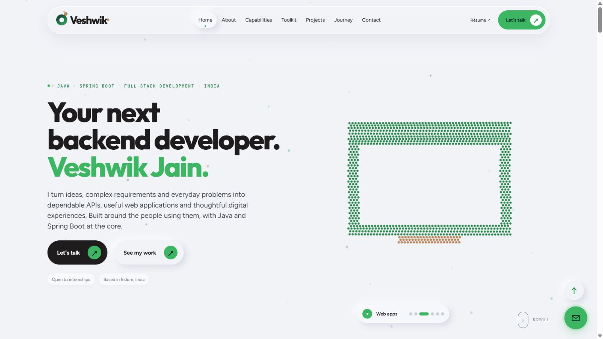
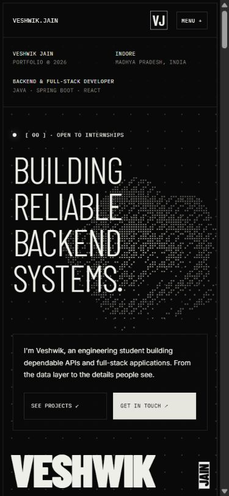

<div align="center">

# Veshwik Jain · Portfolio

**Good ideas. Thoughtful code. Built with React.**

A personal developer portfolio with an animated dot sculpture, scroll reveals, detailed project pages, and a responsive layout.

[Live portfolio](https://veshwikjain.embarko.app/) · [Explore the code](src/App.jsx) · [Run locally](#run-locally) · [Report a bug](../../issues/new?template=bug_report.yml)

[](https://github.com/VJ-veshwikjain2215/Veshwik-Jain-portfolio/actions/workflows/ci.yml)
[](LICENSE)
[](https://react.dev/)

</div>

[](https://veshwikjain.embarko.app/)

<details>
<summary>Phone preview</summary>



</details>

## The experience

This portfolio introduces my work in Java, Spring Boot, and full-stack development. It pairs a light-and-green visual system with original canvas animation and practical project information.

- **Morphing particle hero** — six procedural Canvas 2D compositions with automatic rotation and manual controls.
- **Interactive capabilities** — keyboard-accessible toolkit tabs, expanding service panels, and scroll-revealed statements.
- **Staggered project grid** — large application previews, category labels, project summaries, and linked case studies.
- **Project detail routes** — screenshots, context, technology lists, source links, and available live demos.
- **Responsive navigation** — desktop anchors and a collapsible phone menu.
- **Motion with an off switch** — the procedural graphic, shape rotation, and scroll reveals respect reduced-motion preferences.
- **Academic journey** — semester results, subjects, marksheets, milestones, and résumé links.
- **Dedicated about and contact pages** — biography, certifications, and a prepared contact flow that confirms an emailed code before sending the message through the separate SMTP backend.

### Selected work

| Project                  | Focus                                           | Source                                                                   |
| ------------------------ | ----------------------------------------------- | ------------------------------------------------------------------------ |
| **TrueVoice**            | Voice authenticity and synthetic-voice defense  | [Repository](https://github.com/VJ-veshwikjain2215/TrueVoice)            |
| **Secure-Crypt**         | Text encryption and decryption with Spring Boot | [Repository](https://github.com/VJ-veshwikjain2215/Secure-Crypt)         |
| **RupeeRakshak**         | Full-stack personal finance management          | [Repository](https://github.com/VJ-veshwikjain2215/rupeerakshak)         |
| **Civic Issue Reporter** | Civic reporting and complaint management        | [Repository](https://github.com/VJ-veshwikjain2215/Civic-Issue-Reporter) |

These are projects showcased by the portfolio; their backends are maintained in their own repositories.

## Built with

| Layer     | Choice                                             |
| --------- | -------------------------------------------------- |
| UI        | React 19, React Router                             |
| Styling   | Tailwind CSS 4 and custom responsive CSS           |
| Animation | Framer Motion and Canvas 2D                        |
| Tooling   | Vite, Oxlint, Prettier                             |
| Forms     | Email-code verification and SMTP                   |
| Hosting   | Embarko                                            |
| Checks    | GitHub Actions: formatting, lint, production build |

## Run locally

Use **Node.js 22.12 or newer** and npm. Node 22 is used in CI.

```bash
git clone https://github.com/VJ-veshwikjain2215/Veshwik-Jain-portfolio.git
cd Veshwik-Jain-portfolio
npm ci
npm run dev
```

Open the Local URL printed by Vite, normally `http://localhost:5173`.

| Command                | Purpose                                 |
| ---------------------- | --------------------------------------- |
| `npm run dev`          | Start the development server            |
| `npm run build`        | Build the production site into `dist/`  |
| `npm run preview`      | Serve the production build locally      |
| `npm run lint`         | Check source with Oxlint                |
| `npm run format`       | Format supported files                  |
| `npm run format:check` | Check formatting without changing files |
| `npm run check`        | Run formatting, lint, and build checks  |

No secret is required to run the portfolio. Google Fonts loads the typefaces over the network. Actual code and message delivery requires SMTP settings on the separate contact backend. See [email setup](docs/EMAIL-VERIFICATION.md); credentials stay outside the frontend.

## Make it yours

The code is MIT licensed. Before publishing a fork, replace the personal content and documents with your own.

1. Edit **[`src/constants/data.js`](src/constants/data.js)** for profile links, projects, skills, academic records, and achievements.
2. Edit **[`src/App.jsx`](src/App.jsx)** for hero copy, profile facts, navigation, and section structure. Some presentation copy is intentionally local to its component.
3. Change the visual system in **[`src/index.css`](src/index.css)**.
4. Replace project images in **`src/assets/`**, the résumé at **`public/resume.pdf`**, and marksheets in **`public/marksheets/`**. Remove documents you do not want to publish.
5. Configure your own SMTP sender and notification inbox in the backend hosting settings, and replace the public API address in `src/config.js`. See [verification setup](docs/EMAIL-VERIFICATION.md). Do not send test messages to the original owner.
6. Update the page metadata, favicon, repository links, and deployment identity. Remove the original `appId` from **`embarko.json`** before deploying a fork.

See [development and deployment notes](docs/DEVELOPMENT.md) for the architecture, verification checklist, and hosting details.

## Project structure

```text
.github/               CI, dependency updates, issue and PR templates
 docs/                 Screenshots and development notes
 public/               Public documents and favicon
 src/
   App.jsx             Routes, homepage sections, canvas animation
   components/         Shared contact form and button
   constants/data.js   Portfolio content and project image imports
   assets/             Project screenshots
   index.css           Typography, layout, responsive styles, motion
   main.jsx            React entry point
 embarko.json          Existing Embarko app identity; no credentials
```

## Accessibility and verification

The interface includes a skip link, semantic landmarks, keyboard focus indicators, labeled form controls, and descriptive links. CSS and the canvas respect `prefers-reduced-motion`.

The redesign was manually checked at desktop and phone widths, including navigation, project pages, direct-route reloads, and empty-form validation. CI checks code quality and build output; it does **not** claim to be a full accessibility audit or an end-to-end message-delivery test.

## Contributing

Bug fixes, accessibility improvements, and performance improvements are welcome. Read [CONTRIBUTING.md](CONTRIBUTING.md) before opening a pull request. Use the [issue templates](../../issues/new/choose) to explain a reproducible problem or a focused idea.

If this project gives you a useful idea for your own portfolio, a star is appreciated.

## Credits and license

Created for **Veshwik Jain**. The current layout, typography, surfaces, colors, and interaction patterns follow [Potadot](https://potadot.com.my/). Personal content, application components, illustrative mockups, and procedural particle artwork are implemented for this portfolio.

Source code is available under the [MIT license](LICENSE). See [personal content and media terms](CONTENT-LICENSE.md). Personal biography, résumé, marksheets, photographs, project screenshots, and third-party names or marks are **not** licensed for reuse by that code license. Fonts and dependencies retain their respective licenses.

[GitHub](https://github.com/VJ-veshwikjain2215) · [LinkedIn](https://www.linkedin.com/in/veshwik-jain/) · [Live site](https://veshwikjain.embarko.app/)

## Design update

The current redesign closely follows the section structure and visual system of [Potadot](https://potadot.com.my/), with Veshwik’s portfolio content and code-generated particle compositions. See [redesign notes](docs/REDESIGN.md) for implementation and verification.
